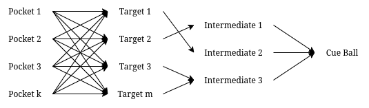
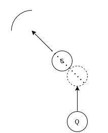
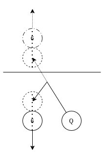
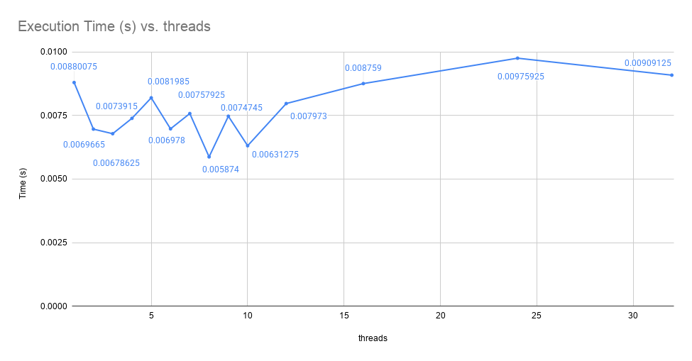

# gem5-benchmarking

If you want to build my project, you can refer to the other repositories in this organization. This repo is just meant to be a place to store my simulation results and scripts. Additionally, given I'm in the course, I can't share the course related gem5 files. So here, I've only posted work that is completely my own, and not part of the course in any way, in accordance with the course's academic integrity policy. I even made sure to work from a publically available branch of gem5 from the course.

Refer to my actual Rust code here: [github.com/bats-eightball/alfred](https://github.com/bats-eightball/alfred)

Below is a summary of my work. This project is definitely more of an application of gem5 to make software decisions than a use of benchmarking to make architectural decisions. I'm happy that I actually get to work on cool architectural things as part of the course though. 

Anyways, happy reading! - Surya Turaga

## Improving a Parallelized Rust Program with gem5

### Problem Statement

I am currently leading a team of 4 for a senior design project. Our goal is to build an autonomous system for gameplay assistance and training in Eight Ball Pool. Keeping track of the game status, it will recommend the most optimal shot to players, displaying it as a projected path on the physical board. The remainder of the project involves physical wireless robots being deployed on the board to move the balls, allowing for move undo and game reset.

My interest was in the computations subsystem of this project. I wanted to explore the question of how to efficiently analyze a game board to compute the most optimal shot, accounting for various factors such as distance, angle, unwanted position changes, etc. With a standard 4K camera providing a live feed, the goal was to compute the result fast enough to keep up with the frame rate. 

I picked this problem to solve as it was fundamentally an optimization problem. The simplest version of the solution involving parsing every possible combination of shots was trivial in implementation complexity, but completely unfeasible considering the state space of the game involving 7 balls and 6 pockets (which would increase when considering reflections). A challenge of speeding up this algorithm on constrained multiprocessors would mean exploration of mathematics for shot calculation, graph traversal for pathfinding, and multithreading / software pipelining for higher parallelization of the program.

Once I was ready with a first draft of my code in Rust, I compiled it into a statically linked executable and ran parametric testing on a 4 core X86 O3 CPU through the gem5 simulator. To allow the processor to have multithreading capabilities, I made use of a full system simulation with the Linux 5.4 Kernel and Ubuntu 18.04 Disk Image. I swept through different thread pool sizes and repeated tests with 10 seed values to collect the mean execution time of the program to process 100 camera frames with different thread pool sizes. Below is an overview of the methods of optimizations I applied to my program, and the final results I obtained.

### Overview of Optimizations

First, I started with the unoptimized design and provided a numerical objective to my program. Although it is not complete and will likely need further adjustment from heuristics,

$$
Risk = R_{opp} + f(dist_0, \phi_0) + \sum_{i=1}^{n} [ f(dist_i, \phi_i) \cdot (1 + K_{depth} \cdot M_{reflect} \cdot N_{opp})^{i} ]
$$

Risk is calculated by penalizing hitting of opponent balls, analyzing the target to pocket path and entry angle, and by penalizing every subsequent multi level chain in terms of distance, angle, and the use of reflections.

I realized that constructing paths from the cue ball to pockets was unfeasible as there was no way of knowing which paths were the most promising until all paths were mapped out. I made the decision to start from the few pockets during traversal and construct paths backwards. This did not affect the initial search space, but allowed subsequent searches to compare their risk against existing baselines, allowing for early abandonment of unpromising paths. This reduced my execution time by approximately 30% as found by Python benchmarking tools.

```python
for pocket in pockets:    # outer loop: every pocket including reflected
    for ball in targets:  # inner loop: every ball including reflected
        if not legal_clear(pocket, ball):
            continue
        path = backtrack(ball, cue) # adds everything it can along the way
        if path is None:
            continue
        r = risk(pocket, path)
        if r < results[ball].risk:
            results[ball] = (pocket, path, r)    # keep lowest-risk shot
```

My next observation was that this method of backward traversal allowed for a strategy of backtracking known as the Ghost Ball method. This simplified risk calculation greatly. While it did not reduce my execution time greatly, it reduced my code size and allowed me to incorporate reflections in my design, treating reflected targets as being part of a separate path that incurred an additional penalty.







The added functionality of reflections increased execution time (almost doubling it) due to the increased search space. Optimizations like adjusting the shot depth and checking angles gave slight improvements.

My next major realization was that paths from target to cue ball were unchanged across pockets, so reuse of my program could be increased significantly by starting from the target instead of the pocket, and adding an optimal pocket at the program end. Each path traversal was also completely independent. This was of significant importance as it opened the doors to multithreading.

At this point, I moved the core logic of my program into Rust. It not only allowed me to run a multithreaded application with ease using the Rayon library, it also served as a good learning experience for the language itself.

```python
table = build_position_table(cue, balls)
pool = ThreadPool(n_threads) # Total available threads
function solve(ball):
    chain = backtrack(ball, cue, table)
    if chain is None:
        return INVALID
    best = INVALID
    for pocket in pockets:
        if legal_clear(pocket, ball, table):
            r = risk(pocket, ball) + risk(chain)
            best = min(best, (pocket, chain, r))
    return best
pool.parallel_map(solve, targets) # one task per ball (real and reflected)
```

The use of the Rayon library allowed me to run many benchmarking tests on my program while adjusting the number of threads available to the program. I utilized Python’s benchmarking library for initial testing, and then used the DerivO3CPU in gem5 to run a compiled binary of my internal Rust program. This helped get a more fair view of program performance, independent of my own host laptop ram and caching techniques.

## Summarized Results

The below results show the total execution time to process 100 iterations for every thread pool count, found as a mean from 10 seed values per thread count. I chose to run 100 iterations as it was sufficient to account for the initial startup costs, which increased linearly with thread count.



Increasing the thread count initially improves the speedup. The program reaches optimal execution time with a thread count of 8 on a 4 core O3 CPU. Increasing threads further begins to degrade performance likely due to context switch overhead. Finally, I hypothesize that after around 16 threads, the number of available threads crosses the peak thread request count. From this point, speedup flatlines as there is no improved benefit to adding new threads.

## Final Thoughts

I liked questioning my own design every step of the way in this project, including the benchmarking phase. I kept finding limitations in my own analysis methods, and tried new ways to get accurate results. This was a very open ended problem that needed a structured design to allow features such as adjustment of thread pool size. 

Discounting the implied difficulty of learning Rust while developing this project, I found it quite challenging to get a full system simulation working. I made use of website walkthroughs on how to write a full system Python file, and carried out AI assisted debugging to understand how to correctly mount an Ubuntu disk image and add my binary executable to it.

Regardless, working on this area of my senior design was a very enjoyable optimization problem that helped me understand the technicals of thread pool based parallel programs better. 

